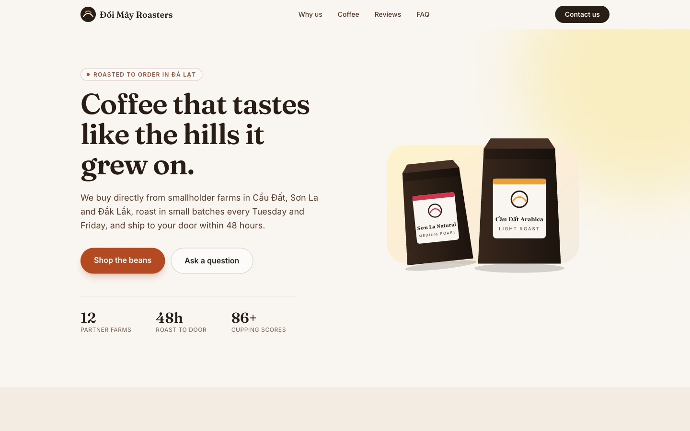

# Đồi Mây Roasters: landing page demo

A one-page landing site for a **fictional** Vietnamese specialty coffee roaster, built as a portfolio sample for "landing page in 24 hours" work.

Next.js 16 (App Router) + TypeScript + Tailwind CSS 4, exported as plain static HTML (`output: 'export'`). No images to download, no backend needed: host the `out/` folder anywhere (Netlify, Vercel, Cloudflare Pages, GitHub Pages, S3).

Sections: hero, features, product cards, testimonials (clearly labelled as sample placeholders), FAQ (with FAQPage JSON-LD), contact form, footer.



## Run it

```bash
npm install
npm run dev      # http://localhost:3000
npm run build    # static site written to ./out
npm start        # preview ./out locally (uses npx serve)
```

Requires Node 20+.

## Customise it in under an hour

| Time | What | Where |
|------|------|-------|
| 15 min | All copy: brand name, hero, features, products, testimonials, FAQ, contact details | `src/content/site.ts` (the only file most projects need to touch) |
| 10 min | Colours and fonts | `src/app/globals.css` (`@theme` tokens: `cream`, `paper`, `bean`, `roast`, `clay`) and the two `next/font` imports in `src/app/layout.tsx` |
| 10 min | Contact form endpoint | copy `.env.example` to `.env.local` and set `NEXT_PUBLIC_FORM_ENDPOINT` |
| 10 min | Logo, favicon, social preview image | `src/components/Logo.tsx`, `public/favicon.svg`, `public/og.png` (1200x630) |
| 10 min | Real product photos | replace `<CoffeeBag>` in `src/components/Products.tsx` with ``/`next/image` (put files in `public/`, write meaningful `alt` text) |
| 5 min | SEO | `NEXT_PUBLIC_SITE_URL` in `.env.local`; title/description come from `site.ts` |

Add or remove a section by editing the list of components in `src/app/page.tsx`. Each section is its own file in `src/components/`.

### Contact form

The form sends a JSON `POST` (`name`, `email`, `topic`, `message`) to `NEXT_PUBLIC_FORM_ENDPOINT`. This works with Formspree, Getform, Basin, or a Make / Zapier / n8n webhook. Any 2xx response counts as success. If the variable is empty, the form runs in **demo mode** and sends nothing. A hidden honeypot field (`company`) silently drops simple bots. The variable is baked in at build time, so rebuild after changing it.

### Before going live

- Replace the sample testimonials with real, permission-granted quotes, and remove the "Sample placeholder" badge in `src/components/Testimonials.tsx`.
- Replace the placeholder email, phone and address in `site.ts`.
- Regenerate `public/og.png` if the hero changes.

## What's built in

- Semantic landmarks (`header`, `nav`, `main`, `section` with `aria-labelledby`, `footer`), skip link, visible focus styles, labelled form fields, `aria-live` form status.
- Title, description, canonical, OpenGraph and Twitter card tags; Store + FAQPage structured data.
- Zero JavaScript for the menu and FAQ (native `<details>`); only the contact form is a client component.
- Self-hosted Google Fonts via `next/font` (no layout shift), SVG illustrations instead of heavy images.
- Respects `prefers-reduced-motion` for smooth scrolling.

## Screenshots

`screenshots/desktop-hero.png`, `screenshots/desktop-full.png`, `screenshots/mobile-hero.png`, `screenshots/mobile-full.png`.

Đồi Mây Roasters is a made-up brand. Any resemblance to a real business is coincidental.
